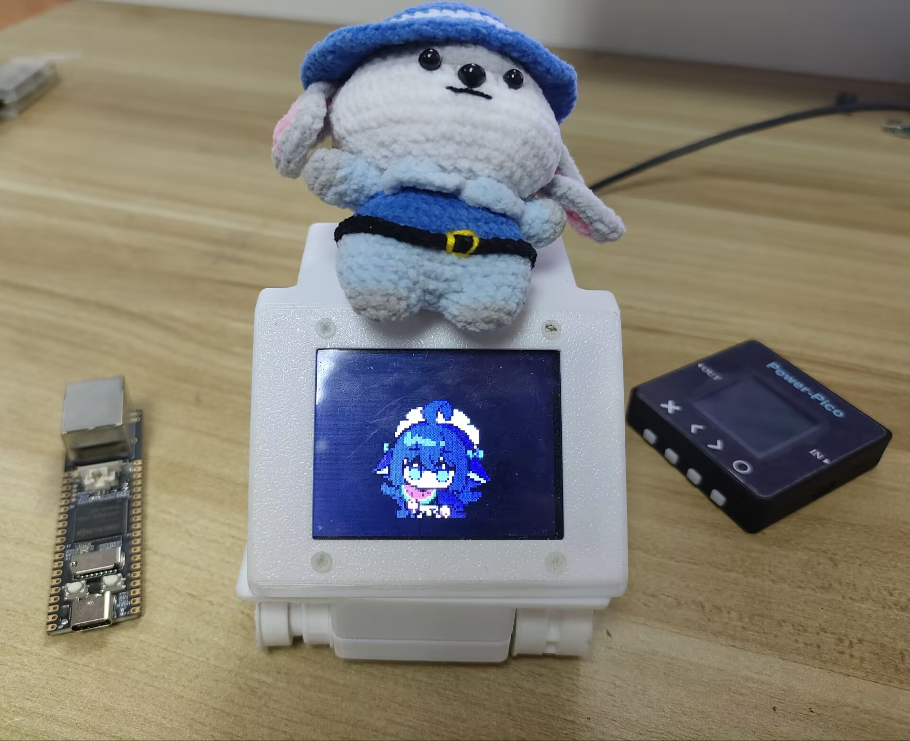

# RV1106 PocketJS 桌宠



把 [PocketJS](https://github.com/pocket-nexus/pocketjs) 带到 RV1106 开发板，让桌宠在小屏幕上动起来、听得见也能回应。项目目前整合了 **35 种表情与动作动画**，并将触摸、录音和动画交给开发板，将语音识别、AI 对话和语音合成交给电脑端处理。

项目采用“开发板负责交互、电脑负责 AI 服务”的结构：

```text
触摸屏 / 麦克风 / 扬声器 / 动画
              │
              ▼
        RV1106 pocket_host
              │ HTTP
              ▼
电脑上的 pocket_pet
              │
       ASR / LLM / TTS
```

开发板负责显示动画、采集触摸和语音、播放语音；电脑端负责语音识别、文字对话和语音合成。开发板不保存 AI 服务密钥。

## 功能

- PocketJS GIF 动画运行时，支持 RV1106 framebuffer 显示。
- 屏幕触摸反馈和触摸区域交互。
- 下半区按住说话，松开后由电脑端完成 ASR、LLM、TTS。
- 上半区触发摸头动画，并通知电脑端生成回复。
- 电脑端提供终端文字对话，不使用电脑麦克风。
- AI 文字回复显示在电脑终端，语音回复通过开发板扬声器播放。
- AI 思考、回复和待机状态使用不同动画。
- Linux 和 Windows 均可构建电脑端独立可执行程序。
- 开发板运行目录只需要 `pocket_host`、`gif_demo.js` 和 `gif_demo.pak`。

## 交互方式

### 电脑端文字对话

在终端输入文字并按回车。电脑端会把请求发送给 LLM，同时通知开发板播放思考和语音回复。

### 开发板触摸屏语音对话

在屏幕中间的下半区按住说话，松开后停止录音。录音数据通过开发板 HTTP 接口被电脑端取走，然后依次执行：

```text
开发板录音 -> 电脑端 ASR -> LLM -> TTS -> 开发板播放语音
```

电脑端终端会显示识别出的文字和 AI 回复。

## 运行环境

### 电脑端

- Linux、WSL 或 Windows。
- [Bun](https://bun.sh/)：仅在从源码构建电脑端程序时需要。
- Windows 构建需要 PowerShell。
- 电脑和开发板处于同一网络，电脑可以访问开发板 HTTP 端口。

运行已经构建好的独立程序时不需要安装 Bun，也不需要浏览器。

### RV1106 开发板

- RV1106 Linux 系统和对应 SDK。
- 可用的 `/dev/fb0` framebuffer。
- 触摸屏、麦克风和 ALSA 音频设备。
- 能够运行本项目提供的 RV1106 交叉编译产物。

本项目默认使用 `root@192.168.9.107` 作为示例开发板地址。发布或部署到其他设备时，请替换为实际地址。

## 快速使用

### 1. 准备配置

```bash
cp pet_config.example.json pet_config.json
```

编辑 `pet_config.json`，至少填写：

- `device.url`：开发板 HTTP 地址，例如 `http://192.168.9.107:17890`。
- `ai.apiUrl`、`ai.apiKey`、`ai.model`：LLM 服务配置。
- `asr.apiKey`、`asr.model`：语音识别配置。
- `tts.apiKey`、`tts.model`、`tts.voice`：语音合成配置。

`pet_config.json` 已被 Git 忽略，不要把真实密钥提交到仓库。

### 2. 启动开发板

把以下三个文件放到开发板同一个目录：

```text
pocket_host
gif_demo.js
gif_demo.pak
```

然后执行：

```bash
chmod +x pocket_host
./pocket_host
```

`pocket_host` 会自动读取可执行文件同目录下的 `gif_demo.js` 和 `gif_demo.pak`，不需要传启动参数。

### 3. 启动电脑端

Linux：

```bash
./pocket_pet
```

Windows：

```powershell
.\pocket_pet.exe
```

推荐将可执行文件和 `pet_config.json` 放在同一个目录。程序查找配置的顺序是：

1. `PET_CONFIG` 环境变量指定的路径。
2. 可执行文件所在目录下的 `pet_config.json`。
3. 当前工作目录下的 `pet_config.json`。

## 从源码构建

### 安装依赖

```bash
bun install
cd third_party/pocketjs
bun install
cd ../..
```

构建 RV1106 目标还需要：

- CMake、GNU Make、Git。
- Rust nightly 和 Cargo。
- RV1106 SDK。
- SDK 对应的交叉编译器。

设置 SDK 路径：

```bash
export ECHO_SDK_ROOT=/path/to/rv1106-sdk
```

`cmake/toolchains/rv1106.cmake` 会从 SDK 中查找交叉编译工具链。不同 SDK 的目录结构可能不同，如查找失败，请按本地 SDK 调整该 toolchain 文件。

首次构建 RV1106 主程序时，还需要先构建 QuickJS 静态库：

```bash
tools/build_quickjs_rv1106.sh
```

### 构建开发板程序

构建脚本默认使用仓库中已提交的处理后 PNG 和 `sprites.json`，不需要原始 GIF：

```bash
tools/build_guest_rv1106.sh
```

如果本地有原始 GIF 并且需要重新生成动画资源：

```bash
RV1106_REGENERATE_ASSETS=1 tools/build_guest_rv1106.sh
```

再编译 RV1106 主机程序：

```bash
cmake --preset rv1106-release
cmake --build --preset rv1106-release
```

主要产物：

```text
build/guest/gif_demo.js
build/guest/gif_demo.pak
build/rv1106-release/pocket_host
```

生成可直接复制到开发板的目录包：

```bash
tools/package_rv1106.sh
```

输出目录：

```text
build/rv1106-package/
```

### 构建电脑端

Linux：

```bash
tools/build_pet_cli.sh
```

输出：

```text
build/pocket_pet
```

Windows，在 PowerShell 中执行：

```powershell
powershell -ExecutionPolicy Bypass -File tools\build_pet_cli_windows.ps1
```

输出：

```text
build\pocket_pet.exe
```

也可以在 Linux 或 WSL 中执行：

```bash
bash tools/build_pet_cli_windows.sh
```

Windows 版本会带 Bun 运行时，用户不需要额外安装 Bun。

## 部署到开发板

默认部署命令：

```bash
RV1106_BOARD=root@192.168.9.107 \
RV1106_REMOTE_DIR=/root/Flower/07_hello_deepseek \
tools/deploy_guest_rv1106.sh
```

脚本会上传 `pocket_host`、`gif_demo.js` 和 `gif_demo.pak`，停止旧进程，更新文件并启动新程序。SSH 登录使用开发板当前配置的认证方式。

需要指定音量时：

```bash
RV1106_AUDIO_VOLUME=1 tools/deploy_guest_rv1106.sh
```

其中 `0` 为静音，`1` 为恢复默认音量。调试时可以先使用 `RV1106_AUDIO_VOLUME=0`。

手动停止开发板程序：

```bash
start-stop-daemon -K \
  -p /tmp/pocket_host.pid \
  -x /root/Flower/07_hello_deepseek/pocket_host
```

## 配置项

完整示例见 [`pet_config.example.json`](pet_config.example.json)。

常用配置包括：

- `idleSeconds`：待机动画切换间隔。
- `responseMultiplier`：AI 回复动画时长倍率。
- `device.url`：开发板 HTTP 地址。
- `ai.personaPrompt`：AI 人格和行为设定。
- `asr`：Qwen 语音识别配置。
- `tts.voice`：语音音色。

只修改 API 密钥、模型、人格或音色时，重启电脑端 `pocket_pet` 即可，不需要重新编译。

## 项目结构

```text
assets/original_gif/       本地可选的原始 GIF，不提交到仓库
assets/processed/          已提交的运行时 PNG、sprites.json 和 pet-assets.ts
app/gif_demo/              PocketJS guest 入口和动画状态机
src/device/                framebuffer、方向和触摸屏
src/runtime/               音频、录音、HTTP 和 PocketJS 宿主逻辑
include/                   C 头文件
tools/pet_server.ts        电脑端终端程序
tools/build_*.sh           Linux、资源和 RV1106 构建脚本
tools/build_*_windows.*    Windows 构建脚本
tools/package_rv1106.sh    开发板目录打包脚本
tools/deploy_guest_rv1106.sh
                           开发板部署脚本
third_party/pocketjs/      PocketJS 源码
third_party/quickjs/       QuickJS 源码
docs/                      架构和维护文档
```

仓库提交的是处理后的 PNG、`sprites.json` 和 `pet-assets.ts`，因此没有原始 GIF 也可以直接构建开发板 guest。`asset-registry.json` 是构建过程中的临时清单，不作为源码提交。

## 开发和排错

检查开发板 HTTP 服务：

```bash
curl --noproxy 192.168.9.107 \
  http://192.168.9.107:17890/event
```

没有待处理事件时返回 HTTP `204` 是正常现象。

开发板运行时环境变量：

- `RV1106_PET_PORT`：HTTP 端口，默认 `17890`。
- `RV1106_PET_CONFIG`：配置文件路径。
- `RV1106_TOUCH_DEVICE`：触摸设备路径。
- `RV1106_MIC_DEVICE`：麦克风 ALSA 设备，默认 `plughw:0,0`。
- `RV1106_AUDIO_DEVICE`：ALSA 音频设备。
- `RV1106_AUDIO_VOLUME`：启动时音量，`0` 到 `1`。
- `RV1106_DISPLAY_ORIENTATION`、`RV1106_DISPLAY_ROTATION`：显示方向。
- `RV1106_TOUCH_FLIP_X`、`RV1106_TOUCH_FLIP_Y`、`RV1106_TOUCH_SWAP_XY`：触摸坐标校正。

如果电脑端提示无法连接，请确认：

1. 开发板上的 `pocket_host` 正在运行。
2. 电脑可以访问 `device.url`。
3. 开发板防火墙或网络隔离没有阻断 `17890` 端口。
4. Windows 下 `pet_config.json` 与 `pocket_pet.exe` 位于同一目录，或设置了 `PET_CONFIG`。

## 添加动画

1. 准备本地原始 GIF，并放入被 Git 忽略的 `assets/original_gif/`。
2. 在 `tools/prepare_gif_rv1106.ts` 的资源映射中加入中文文件名和英文 ID。
3. 运行 `bun tools/prepare_gif_rv1106.ts` 重新生成处理后的资源。
4. 提交更新后的 `assets/processed/`，不要提交 `assets/original_gif/`。
5. 根据需要在 `app/gif_demo/` 的状态机中引用新的动画。

## 开源说明

本项目自身代码使用 MIT License，见 [`LICENSE`](LICENSE)。

`third_party/pocketjs` 和 `third_party/quickjs` 是保留在仓库中的第三方源码，分别遵循各自目录中的许可证文件。发布二进制文件时也应保留对应的版权和许可证信息。

## 相关项目

- [PocketJS](https://github.com/pocket-nexus/pocketjs)
- [Echo-Mate](https://github.com/No-Chicken/Echo-Mate)
